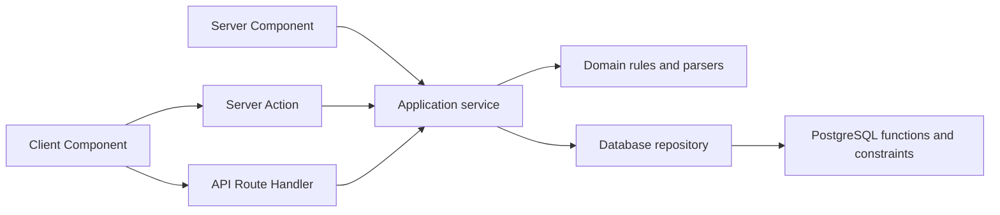

# Architecture and task navigation

Use the relevant [feature-map entry](feature-map.md) to find a task's source, contracts and first checks. Read this overview when the architecture is unfamiliar. Verify the linked code, including whether the requested behavior already exists; neither this map nor an old ticket proves current runtime behavior.

The [MVP specification](../mvp-spec.md) owns product requirements; [AGENTS.md](../../AGENTS.md) owns contributor policy. Consult the task's specific spec sections and applicable [identity/data](../mvp-spec.md#8-identity-data-and-demo-integrity), [security](../mvp-spec.md#10-security-and-failure-invariants), [recovery](../mvp-spec.md#7-requests-booking-and-recovery) and [acceptance](../mvp-spec.md#13-acceptance-matrix) requirements. Expand discovery when dependencies cross capabilities.

## Source responsibilities

| Location                                                                         | Start here for                                                                                    |
| -------------------------------------------------------------------------------- | ------------------------------------------------------------------------------------------------- |
| [src/app](../../src/app/)                                                        | Next.js pages, route composition, Server Actions and API Route Handlers.                          |
| [src/features](../../src/features/)                                              | Capability screens, interactive state and presentation models.                                    |
| [src/components](../../src/components/)                                          | Shared interface components.                                                                      |
| [src/domain](../../src/domain/)                                                  | Framework-independent rules, commands and parsers.                                                |
| [src/server](../../src/server/)                                                  | Session/actor authorization and application services.                                             |
| [src/server/db](../../src/server/db/)                                            | PostgreSQL connections, actor transactions, schema mappings and repositories.                     |
| [src/auth](../../src/auth/), [server/auth](../../src/server/auth/)               | Application identity contracts/browser adapters and server credential verification.               |
| [src/location](../../src/location/), [server/storage](../../src/server/storage/) | Map/search and image-storage provider boundaries.                                                 |
| [supabase](../../supabase/)                                                      | Current migration chain, seed and SQL tests; operations in its [guide](../../supabase/README.md). |
| [tests](../../tests/), [scripts](../../scripts/)                                 | Unit/server/database/browser assertions and isolated rehearsals with their own prerequisites.     |

## Runtime paths

Pages can call services directly; server calls do not require an HTTP hop. For example, [coach workspace](../../src/app/coach/page.tsx) loads services and passes [Server Actions](../../src/app/coach/availability-actions.ts) to its editor. [Typed booking](../../src/features/session-types/public-booking.tsx) instead fetches a [Route Handler](../../src/app/api/coaches/[slug]/session-types/route.ts). Follow the actual imports for each flow.

## Trust and persistence

An actor combines verified account identity, application profile and dataset role. A dataset, called a `demo run` in existing identifiers, groups application records; it is neither a workout nor a login session. [Authorization services](../../src/server/authorization/service.ts) resolve that identity; [actor transactions](../../src/server/db/authorization/repository.ts) install and validate database context.

Services validate input and gate access. SQL functions and constraints own persistent lifecycle checks, owner/dataset permissions, concurrency, retries and scheduling conflicts. Inspect both layers: authenticated private-time reads deliberately use a separate public-availability projection after authorization, keeping owner overrides out of athlete availability. Some public group queries reconcile expired lifecycle state; a public query is not necessarily a side-effect-free SQL operation.

Drizzle schema mappings are not the complete database contract. Follow repository function names through [current migrations](../../supabase/migrations/) in order, including later replacements. The [migration archive](../../supabase/migration-history/README.md) supplies preserved history, not another live migration chain. Scheduling instants and timezone/full-duration fit ultimately follow SQL authority; client previews grant no permission.

## Dependencies: enforced rules and current exceptions

[Boundary tests](../../tests/boundaries.test.ts) restrict database packages to `server/db`, domain imports to domain modules, shared components from importing features/server, and feature or Client Component imports of server modules. They also check Auth SDK and Storage adapter boundaries. This is not a complete dependency-graph validator.

The intended separation keeps domain contracts independent and composes services at application entry points. Current server-to-feature dependencies still exist: [availability service](../../src/server/coaches/availability-editor-service.ts) imports an editor model, and [Events directory service](../../src/server/group-sessions/directory-service.ts) imports feature contracts. Tests currently permit this direction. These are observations to account for during changes; relocating contracts requires separate refactoring scope.

## Validation navigation

Use the feature map's focused checks first, then broaden according to the issue and [definition of done](../mvp-spec.md#11-definition-of-done). [README checks](../../README.md#checks), [package scripts](../../package.json) and [database operations](../../supabase/README.md#local-development-and-database-tests) provide setup and broader commands. Read a rehearsal's target, skip conditions and cleanup before running it. Existing assertions and fixture rehearsals do not establish real authorization, persistence or deployment proof.
